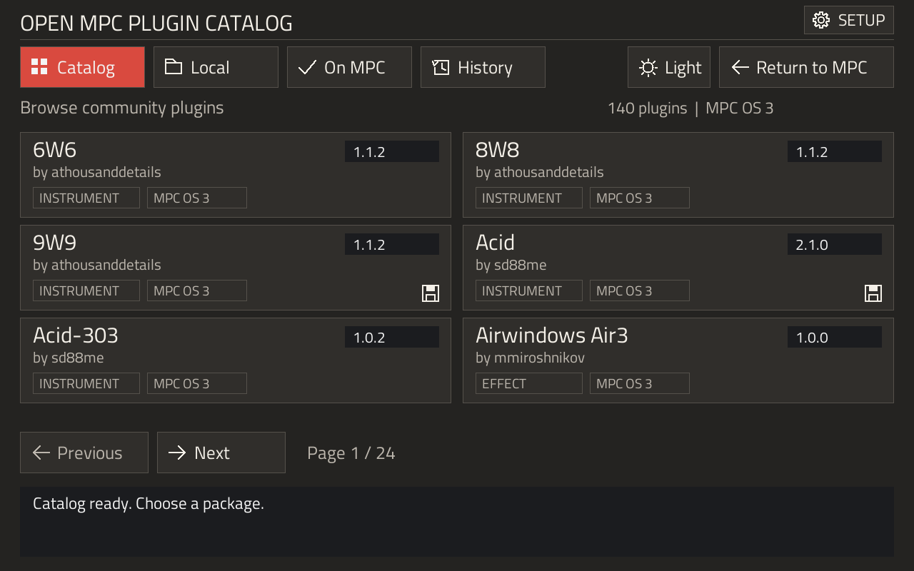
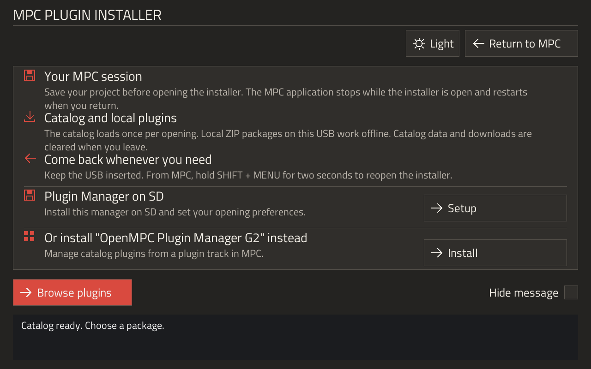
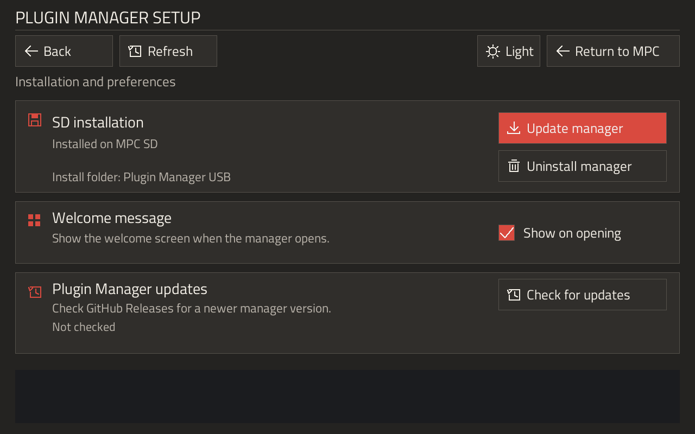
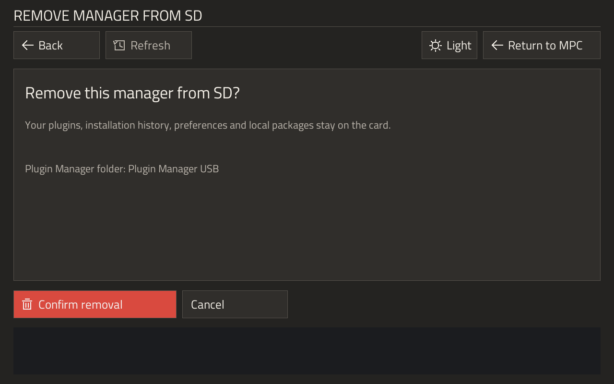
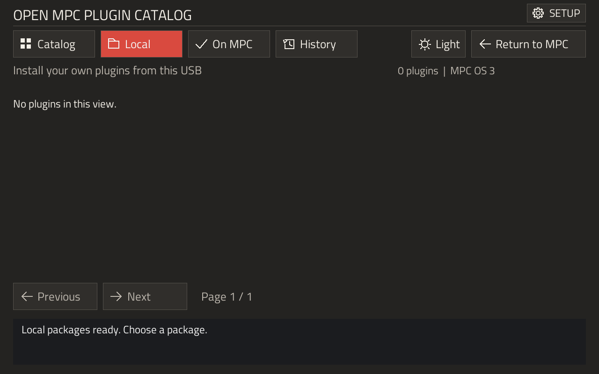
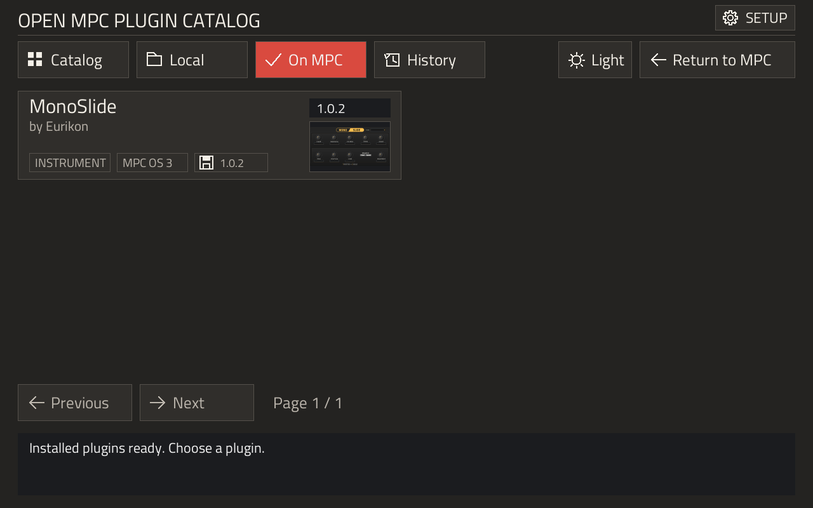
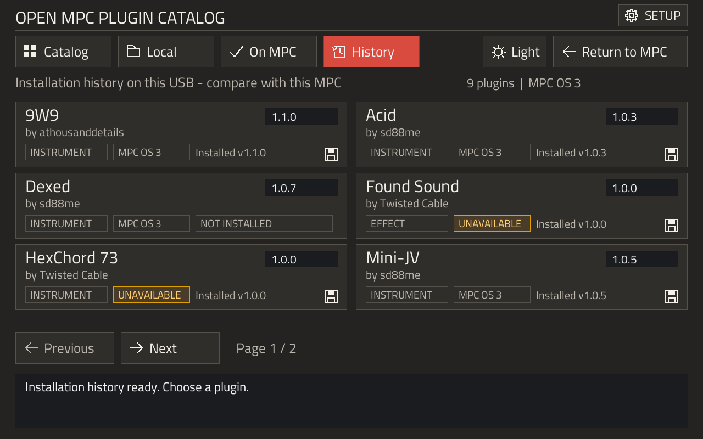

# Plugin Manager USB for OPEN MPC

[](https://github.com/Eurikon/plugin-manager-usb-for-open-mpc/releases/download/v1.3.0/plugin-manager-usb-v1.3.0-migration.zip)
[](https://github.com/Eurikon/plugin-manager-usb-for-open-mpc/releases/latest)
[](CHANGELOG.md)
[](https://eurikon.github.io/plugin-manager-usb-for-open-mpc/guide.html)
[](LICENSE)

Browse, install, update and remove community instruments and effects on your MPC touchscreen.<br>
Run the manager from USB, or install the manager itself onto SD on supported OS 3.10 devices.

The bundle includes the manager, without plugins or Akai firmware files.

**MPC Live 2 - Gen1 / AKAI MPC OS 3.9.1 and 3.10** (MPC Live II Retro test unit).<br>

**Additional hardware checks:** Akai Force — OS 3.9.1; MPC Live III (Gen2) — OS 3.10 over OS 3.9.1.<br>
Beta 2 was tested and approved on these configurations.<br>
The 1.3.0 updater and interface changes have offline validation; no new device-test result is claimed.<br>
Stock Gen2 OS 3.9.1 and 3.10 have also passed offline firmware checks; stock Gen2 OS 3.10 has not been hardware-tested.<br>

One USB bundle selects the Gen1 or Gen2 runtime automatically.<br>
Use ARM64 plugin packages on Gen2; ARMv7 packages are rejected before installation.

### Updating an existing installation

The new signed updater needs one complete-bundle migration from 1.2.x or earlier.
Later compatible releases can update the manager and its helper together through SETUP.

1. Save your project and safely eject the drive before connecting it to your computer.
2. Extract the new archive onto the USB root, replacing matching application files and including `.mpc-manager-id`. Preserve `plugin-history.json`, `manager-preferences.json`, `display-rotation.txt` if present, and `local-plugins/`.
3. On OS 3.10, reimport `Plugin Manager helper.xpa` into internal MPC Documents, then shut down normally and switch the MPC back on. This clears the previous RAM session.
4. If you use the SD copy, open the updated USB manager and choose **SETUP → Update manager** before removing the stick.



On your computer, extract the ZIP first, then copy its contents rather than the enclosing extraction folder.<br>
Show hidden files to include `.mpc-manager-id`.<br>
Windows File Explorer and macOS Finder can extract ZIPs.<br>
Development tools and firmware extraction are only needed when building from source.

## Using a Prepared USB Bundle

You need an MPC-formatted USB stick and the MPC's registered `Expansions` content folder.<br>
Use your computer to copy the bundle onto the stick; no SSH, development tools or ongoing computer connection is needed.<br>
The online catalog needs internet on the MPC; local plugin ZIPs can be installed offline.

**Save your project first.**<br>
Opening the manager stops the MPC application; returning starts it again.

Copy the bundle contents directly onto the USB stick, without an extra enclosing folder.<br>
Keep `autorun/`, `.mpc-manager-id`, `USB-SHA256.json`, `local-plugins/` and `Plugin Manager helper.xpa` together at the root.

### MPC OS 3.9.1

Insert the stick and choose **Open** in the stock script prompt.<br>
The welcome screen opens; no helper import is needed.

### MPC OS 3.10: first use

The first insertion does not show the older script prompt.<br>
Import the supplied helper once:

1. In MPC's Browser, open the USB stick and select `Plugin Manager helper.xpa`.
2. Choose **Load**, select the internal **MPC Documents** folder as the extraction destination, then confirm with **Save**. Do not extract beside the XPA on the USB stick.
3. Let extraction finish. It creates `Devices/Plugin Manager helper` inside MPC Documents.
4. Shut down the MPC normally, then switch it back on to activate the helper. Keep the USB inserted; hold **Shift + Menu for two seconds** to open the manager.

The helper is a controller profile, not an instrument or effect.<br>
Its files remain in MPC Documents so it can start again after a normal reboot.<br>
The blank setup project is removed after successful setup only if it is unchanged; a modified project or failed setup is left for inspection.

### Later openings

On 3.10, a fresh USB insertion offers **Open** or **Cancel**.<br>
After a cold boot with the stick already inserted, MPC stays on MAIN; use **Shift + Menu for two seconds** when you want the manager.<br>
A short press retains the MPC Browser shortcut.<br>
The helper does not need importing again after each opening or reboot.

Choose **Browse plugins** on the welcome screen, then select a compatible package from **Catalog** or **Local**.<br>
Confirm its installation into the MPC's managed Expansions folder, then install more packages or choose **Return to MPC**.<br>
Installed instruments and effects become available through MPC's normal plugin selection.

Returning to MPC can take **30 seconds or longer**.<br>
Wait for MPC to finish reopening; **do not turn off your device during this transition**.

## Welcome Screen



| Section or control | What it does |
| --- | --- |
| **Your MPC session** | Reminds you to save before the manager stops the MPC application. |
| **Catalog and local plugins** | Explains online browsing and offline ZIP installation from the selected USB or SD source. |
| **Come back whenever you need** | Shows the two-second **Shift + Menu** shortcut. Keep the source drive inserted. |
| **Plugin Manager on SD → Setup** | Opens SD installation, welcome preferences and manager updates. |
| **Or install "OpenMPC Plugin Manager G2" instead** | Offers an optional manager that runs on an MPC plugin track. |
| **Hide message** | Skips this welcome screen on later openings from this source. Restore it in **SETUP → Show on opening**. |
| **Browse plugins** | Opens the catalog without leaving the manager. |
| **Return to MPC** | Closes the manager and restarts the MPC application. |
| **Sun / moon** | Switches between light and dark themes. The label names the theme you will switch to. |

The welcome screen also offers **OpenMPC Plugin Manager G2**, which runs on an MPC track and supports Gen 1 and Gen 2.<br>
Its button offers **Install** when absent, or **Update** when an older, known release is installed in the selected plugin location.<br>
**Installed** is disabled for equal, newer or unknown versions and installations outside that location.<br>
The regular catalog still allows deliberate reinstallation.<br>
Choosing **Install** or **Update** authorizes the operation directly.<br>
The latest stable release must match the current catalog before the package is downloaded and checked; failed verification stops installation.<br>
No plugin package is downloaded before you choose an enabled action.

## Install the Manager on SD

This optional feature requires the supported **OS 3.10 helper**.<br>
It installs the manager application on the removable SD card; it does not install an instrument on a track.

1. Open **Setup** from the welcome screen, or the cogwheel **SETUP** button above the catalog.
2. Choose **Install to SD**, select your SD card and confirm installation.
3. Choose **Return to MPC** and wait for MAIN.
4. Safely eject and remove the USB stick. Keep the SD card inserted and hold **Shift + Menu for two seconds** to open the SD copy.

The manager lives in `Plugin Manager USB/` at the SD card's root.<br>
Only supported removable SD cards are offered; internal storage and SSDs are excluded.<br>
The helper stays in internal MPC Documents, separate from the SD application.

Starting MPC or reinserting the SD card does not automatically open the manager.<br>
Use the shortcut to open it.<br>
With the SD copy available, a fresh USB insertion still offers a USB session: **Open** selects USB; **Cancel** keeps the SD selection.<br>
The same interface is used for both sources; each source keeps its own preferences, history and `local-plugins/` folder.

## Setup and Manager Updates



- **Plugin Manager installation:** install, update/reinstall or uninstall the SD copy. **Update manager** copies the current session's manager onto SD; it is separate from downloading a new release.
- **Plugin Manager updates:** choose **Check for updates** to check GitHub Releases. If a supported newer release is available, **Install update** opens a confirmation before downloading and installing it.
- **Welcome message:** enable **Show on opening** to restore the welcome screen for this source.

An accepted release updates the manager you opened, together with its helper, while preserving plugins, history, preferences and local ZIPs.<br>
Keep its drive connected, return to MPC and reopen the manager to use the update.<br>
The previous working version is retained for recovery if the new version cannot start.<br>
USB and SD keep independent versions; use the updated USB copy’s **Update manager** action to bring an older SD copy up to date.

### Remove the SD copy

Choose **Uninstall manager**, then review the confirmation before removing it.



Removal deletes the recognized manager application files and its SD registration.<br>
Installed plugins, history, preferences, local packages and unrelated files remain.<br>
The `Plugin Manager USB/` folder can therefore remain after uninstalling.<br>
The controller helper remains available for USB use; removing the SD copy does not remove that helper.

Wait for MPC to reopen after uninstalling.<br>
Do not remove the card or turn off the device during the transition.

If opening briefly goes black and returns to MPC, preserve `bootstrap-result.txt` and `manager-result.txt` from the USB root for your report.<br>
The first records why the helper refused to launch; the second can record a manager crash after launch.<br>
These logs can be read on your computer without SSH.

## Find, Update and Remove Plugins

| Tab | Use it for |
| --- | --- |
| <picture></picture> **Catalog** | Browse online community releases and check compatibility before downloading. |
| <picture></picture> **Local** | Install plugin ZIPs you copied into `local-plugins/`. |
| <picture></picture> **On MPC** | See plugins actually present on the device and select available update/removal actions. |
| <picture></picture> **History** | Compare this stick's saved installation record with the current device and available packages. |

The top-right version is the package offered in that tab.<br>
A floppy symbol and version beside the MPC OS badge identify the installed copy; a small light beside the offered version indicates a newer update.<br>
Thumbnails load into RAM and are discarded when the manager closes.

Uninstall removes the managed plugin and its registration, while keeping its history entry.<br>
History helps identify previous installations after wiping or changing a device; it does not back up projects or plugin files.







Theme and welcome-message preferences stay on the source USB or SD card.<br>
Page positions last only while the manager is open.<br>
The catalog and downloaded packages are kept temporarily in RAM and discarded when the manager closes.

## What Changes on the MPC?

Plugin files go to `/sdcard/Expansions`; retained uninstall scripts go into `.mpc-usb-manager/` there.<br>
On the tested Live II, `/sdcard` is internal content storage; it is separate from the removable SD card selected for the manager application.<br>
Package scripts run as root and update `MPC.settings`.<br>
The installer does not replace your firmware.<br>
Its launch mechanisms are firmware-specific and may change after an Akai update.<br>
On 3.10, the imported helper persists in MPC Documents; the running manager and shortcut session are prepared in RAM.<br>
No root-filesystem startup service is installed.

Checksums detect damaged or changed files; they do not certify who wrote a plugin or whether its scripts are safe.<br>
Use packages from publishers you trust.<br>
Recovery and user-data preservation depend on each package's scripts.<br>
Content outside the managed target needs its original installer.

After five idle minutes, the manager returns to MPC.<br>
An unexpected exit triggers an immediate application restart.<br>
USB removal during installation can interrupt the operation.<br>
Follow the MPC's own drive-removal instructions.

### Plugin Installation Location

The plugin destination is separate from the USB or SD location of the Plugin Manager application.<br>
Gen 1 keeps its existing `/sdcard/Expansions` destination on internal storage; a removable SD card is not required for those plugins.<br>
On Gen 2, **SETUP → Plugin location** opens **Plugin installation location**.

- **Automatic** follows MPC's **Content Download Drive** selection and uses that drive's `Synths` folder.
- Select another listed location and choose **Use selected**, or choose **Browse folders**, open an existing folder and choose **Use this folder**. A custom folder does not have to be named `Synths`.
- Manual selection applies to the current manager session. **Automatic** restores MPC's selected content drive.

Selecting a location does not install anything or change MPC's content-drive preference.<br>
After you confirm a plugin installation and its package passes validation, the manager creates the standard `Synths` folder if needed and registers the chosen content folder, preserving a backup of MPC settings.<br>
A missing, disconnected or read-only drive stops installation with an explanation; the manager does not silently switch drives.<br>
Plugins installed on removable storage require that storage to remain available when MPC loads them.

Some drives can store samples and projects but are blocked from running plugins.<br>
This restriction is called `noexec` and can affect an SSD, SD card or USB drive.

On Gen 2, these drives do not appear in **SETUP → Plugin location**.<br>
If MPC's selected content drive is blocked, **Automatic** is unavailable and the page explains which drive cannot run plugins.<br>
If no usable drive is connected, the list is empty and shows **“No writable, executable plugin drive is available.”**<br>
The location-selection buttons are disabled, and no plugin is installed.<br>
Connect another drive and tap **Refresh**.<br>
When a usable location appears, select it to continue.

## Opening and Recovery

- **No first-use prompt on 3.10:** import `Plugin Manager helper.xpa` into internal MPC Documents and restart the MPC application once.
- **No automatic opening after boot:** this is intentional. Hold **Shift + Menu for two seconds**.
- **SD copy unavailable:** reinsert the SD card and try the shortcut again, or insert the prepared USB stick. Reinserting SD is silent.
- **Welcome screen skipped:** open **SETUP** and enable **Show on opening**.
- **Screen upside down:** create `display-rotation.txt` containing `180` in the manager’s folder on the USB stick or SD card, then reopen it. `0` or no file keeps the automatic orientation. A first SD installation copies the USB setting. The result log records display details for diagnosis.
- **Slow return to MAIN:** allow **30 seconds or longer** on Gen 1 hardware. Do not turn off the MPC while its application is restarting.
- **Remove the 3.10 helper completely:** first uninstall the SD manager if present. In MPC's Browser, remove only `MPC Documents/Devices/Plugin Manager helper`, then restart normally. Keep other controller profiles in `Devices`.

## Building the Manager

The [Developer FAQ](DEVELOPER_FAQ.md) covers the source, USB launch mechanism, package format, recovery and release preparation.

Development tools were tested on an **Apple Silicon Mac** with **macOS 26.6.2**.<br>
Builds and offline tests use Docker.<br>
**Windows and Linux development setups haven’t been tested.**

Requirements: Python 3.10 or later, GNU Make and Docker with `linux/arm/v7` and `linux/arm64` support.<br>
Run from this checkout:

```sh
make syntax
make arm
make arm64
```

`make syntax` checks Python and shell scripts.<br>
`make arm` builds with warnings as errors in the `mpc-usb-plugin-installer-build-tools` Docker image.<br>
Creating the image downloads dependencies; compilation runs with networking disabled.<br>
Outputs stay in ignored `build/`.<br>
No sibling project is needed.<br>
Signed releases also need OpenSSL 3 and the matching publisher signing key; see the [Developer FAQ](DEVELOPER_FAQ.md#how-are-manager-updates-authorized).
The build includes `build/startup/manager-entry.so`, compiled from `src/startup/`.<br>
Use `make arm-helper` to rebuild only that helper with the existing build image.

`make arm64` uses the same Dockerfile with `gcc:12` and writes the Gen 2 runtime and helper to `build/aarch64/`.<br>
Its image is `mpc-usb-plugin-installer-build-tools:aarch64`; the ARMv7 outputs remain separate in `build/`.

## Building a USB Bundle Without Redistributing Firmware

Supply official Gen1 update images for OS 3.9.1 and OS 3.10, plus a blank standalone MPC project you saved yourself.<br>
The setup project must have no samples or saved sequences.<br>
It is used only for the one-time 3.10 helper import; its unchanged copy is removed after setup.

After building both architectures, run from this checkout using absolute input paths:

```sh
UPDATE_39="/path/to/MPC-3.9.1-Gen1-update.img"
UPDATE_310="/path/to/MPC-3.10-Gen1-update.img"
SETUP_PROJECT="/path/to/Blank.xpj"
SIGNING_KEY="/path/to/private/pmu-release.pem"
OUTPUT_DIR="$PWD/build/universal-package"
mkdir -p "$OUTPUT_DIR"
docker run --rm --pull never --platform linux/arm64 --network none \
  --mount "type=bind,src=$PWD,dst=/work,readonly" \
  --mount "type=bind,src=$UPDATE_39,dst=/input/update39.img,readonly" \
  --mount "type=bind,src=$UPDATE_310,dst=/input/update310.img,readonly" \
  --mount "type=bind,src=$SETUP_PROJECT,dst=/input/Blank.xpj,readonly" \
  --mount "type=bind,src=$SIGNING_KEY,dst=/input/release.pem,readonly" \
  --mount "type=bind,src=$OUTPUT_DIR,dst=/output" \
  -w /work mpc-usb-plugin-installer-build-tools:aarch64 sh -ec '
    python3 tools/extract_firmware.py /input/update39.img /tmp/mpc39
    python3 tools/extract_firmware.py /input/update310.img /tmp/mpc310 --controller-helper
    python3 package.py /tmp/mpc39/usr/bin/MPC /output/usb \
      --mpc-310 /tmp/mpc310/usr/bin/MPC --setup-project /input/Blank.xpj \
      --signing-key /input/release.pem
  '
```

The output contains both the legacy USB launcher and `Plugin Manager helper.xpa` for 3.10.<br>
The extracted firmware stays inside the disposable container.<br>
`/output/usb` must not already exist; an existing destination is preserved.

If you already have the extracted executables, the packaging command is:

```sh
python3 package.py /path/to/MPC39 build/universal-usb \
  --mpc-310 /path/to/MPC310 --setup-project /path/to/Blank.xpj \
  --signing-key /path/to/private/pmu-release.pem
```

`--legacy-layout` explicitly selects the older unsigned packaging route for compatibility tests; it is not the release format.<br>
The legacy checksum uses bounded automatic salt scanning.<br>
The controller helper requires each generation's verified stock OS 3.10 executable because its native UI bindings are specific to that build.<br>
Unknown or mismatched inputs stop packaging.<br>
Firmware executables are not copied into the bundle; plugin packages are omitted by default.

### Add Gen 2 to the same bundle

Build both architectures, then extract the Gen 2 OS 3.9.1 executable with `tools/extract_firmware.py` and its OS 3.10 executable with the same tool's `--controller-helper` option.<br>
The extractor checks the section table, embedded section checksums and compressed filesystem integrity.<br>
Compare the two generations' OS 3.9.1 autorun data with `package.validate_mpc_executable()`; the supported images decode the same salt.<br>
Package both runtimes with:

```sh
python3 package.py /path/to/Gen1-MPC39 build/universal-gen2-usb \
  --mpc-310 /path/to/Gen1-MPC310 --setup-project /path/to/Blank.xpj \
  --arm64-build build/aarch64 --mpc-310-arm64 /path/to/Gen2-MPC310 \
  --signing-key /path/to/private/pmu-release.pem
```

Signed complete versions live under `autorun/runtime/.pmu-versions/`; each version includes both native runtimes and shared assets.<br>
The fixed source dispatchers select and verify the appropriate version before copying it to RAM.<br>
The helper XPA contains both native modules and selects one using Lua's native pointer size.<br>
Gen 2 reads settings from `/data/Settings/MPC/MPC.settings` and uses the firmware-selected content drive or an explicitly chosen writable, executable plugin folder.<br>
Installing the manager itself remains restricted to a removable SD card.

## Broader Offline Tests

For offline evaluation, developers supply their own plugin packages and official firmware outside the checkout.<br>
Run package scripts only in a disposable Linux environment, using packages you trust.<br>
The repository provides no plugin payloads or Akai firmware files.

Offline checks cover installation/removal, inventory, package rejection, interface navigation, recovery and shortcut behavior.<br>
Run `make test-local TEST_PACKAGE_ZIP="/path/to/your-plugin.zip"` for local runner, packaging, firmware scanner and setup checks.<br>
Checks needing an optional package report a skip when that input is absent.<br>
An offline pass does not extend the recorded hardware compatibility: display/touch behavior, USB notifications and device CPU performance still need hardware testing.<br>
See the [Developer FAQ](DEVELOPER_FAQ.md#testing-and-troubleshooting) for the disposable firmware test recipe and troubleshooting.

## Source Layout and Integration

`src/` owns the SDL interface, installation backend and shortcut supervisor; `tools/` owns deployment/extraction helpers.<br>
Top-level shell scripts control the transient RAM session.<br>
`assets/` and `licenses/` hold the font and notices; `tests/` holds reusable checks.

Other development projects can set `MPC_MANAGER` to this checkout's path.<br>
See the [Developer FAQ](DEVELOPER_FAQ.md#how-do-i-use-this-checkout-from-another-development-project) for path resolution and integration details.

## Credits and Acknowledgments

This project builds on **sd88me**'s [mpc-vst-plugins](https://github.com/sd88me/mpc-vst-plugins) catalog, package format and installation tooling.<br>
The [upstream copyright notice](licenses/community-tools.txt) is preserved in the repository and USB bundles.<br>
See the [upstream credits](https://github.com/sd88me/mpc-vst-plugins#credits) for community contributors.

**Twisted Cable** develops this on-device USB manager, its interface, reopening shortcut, installation inventory and firmware-based offline testing workflow.<br>
Plugin authors retain ownership and licenses for their own packages; plugins are downloaded separately and are not included in this repository.

## Licensing

Original manager code is [MIT licensed](LICENSE).<br>
Third-party components retain their own licenses: Titillium Web uses SIL OFL 1.1, SDL2 uses zlib, and nlohmann JSON uses MIT.<br>
Bundles include these notices and the manager's license.<br>
Preserve them when redistributing.

## Disclaimer

Use this installer on your hardware at your own discretion and risk.<br>
It is provided **as is, without warranty**.<br>
This independent community project is not affiliated with or endorsed by Akai.
